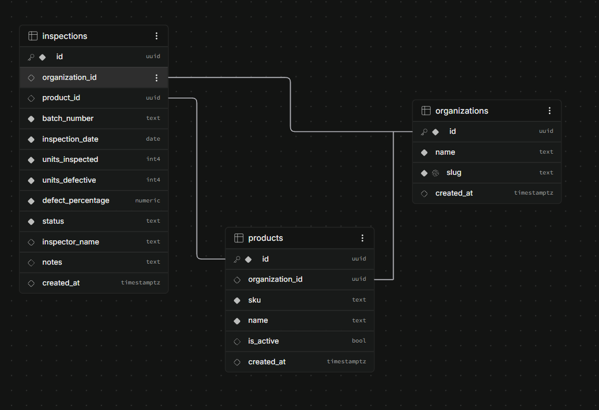

# Control de Calidad · Inspección de lotes

Aplicación para registrar inspecciones de calidad por lote de producción. Calcula el porcentaje de defectos y el resultado de cada inspección, permite filtrar por producto y resultado, y muestra métricas globales del conjunto filtrado.

**Deploy:** https://batch-inspection-project-sigma.vercel.app/
**Repositorio:** https://github.com/DavidHz26/batch-inspection-project

---

## Contenido

1. [Stack](#stack)
2. [Funcionalidad](#funcionalidad)
3. [Requisitos](#requisitos)
4. [Instalación y ejecución local](#instalación-y-ejecución-local)
5. [Base de datos: migraciones y catálogo inicial](#base-de-datos-migraciones-y-catálogo-inicial)
6. [Lógica de clasificación](#lógica-de-clasificación)
7. [Pruebas](#pruebas)
8. [Decisiones de UX](#decisiones-de-ux)
9. [Backend y API](#backend-y-api)
10. [Deploy](#deploy)
11. [Declaración de uso de IA](#declaración-de-uso-de-ia)
12. [Decisiones y pendientes](#decisiones-y-pendientes)

---

## Stack

| Capa | Tecnología |
|---|---|
| Frontend | Next.js 16 (App Router y Server Components), React 19, Tailwind CSS 4 |
| Backend | Integrado en Next.js: Server Actions para los formularios y Route Handlers (`app/api/*`) como API REST |
| Base de datos | PostgreSQL en Supabase, con migraciones SQL versionadas en `supabase/migrations/` |
| Gráficas | Recharts |
| Pruebas | Jest + React Testing Library |

## Funcionalidad

Cobertura del alcance solicitado:

- **Captura de inspecciones** con producto, lote, fecha, unidades revisadas y unidades defectuosas, todos obligatorios. El porcentaje y el resultado se calculan en el servidor y no se capturan.
- **Tabla de inspecciones** ordenada de la más reciente a la más antigua (por fecha de inspección y luego por fecha de registro), con porcentaje de defectos y resultado.
- **Filtros por producto y resultado.** El botón *Clean* restablece todos los registros.
- **Tarjetas de métricas** del conjunto filtrado: número de inspecciones, unidades revisadas y porcentaje global de defectos. Usan exactamente los mismos filtros que la tabla, por lo que siempre coinciden.
- **Persistencia en PostgreSQL:** los registros se conservan al recargar.
- **Estados de confirmación, validación, carga, error y lista vacía.** Se describen en [Decisiones de UX](#decisiones-de-ux).
- **Validación en la interfaz y en el backend** con las mismas reglas.

Funcionalidad adicional (fuera del alcance requerido; ver [Decisiones y pendientes](#decisiones-y-pendientes)): dashboard con gráficas, catálogo de productos, edición y borrado, y manejo de varias organizaciones.

## Requisitos

- **Node.js 20.9 o superior** (requerido por Next.js 16) y npm.
- **Un proyecto de Supabase** (el plan gratuito es suficiente). Las migraciones usan el rol `anon` de Supabase, por lo que no se ejecutan tal cual en un PostgreSQL sin Supabase.
- *Opcional:* [Supabase CLI](https://supabase.com/docs/guides/cli) para aplicar migraciones desde la terminal, y Docker si quieres levantar Supabase en local.

> **Pasos manuales.** La instalación, las pruebas y el build se pueden ejecutar de forma automática, pero la base de datos requiere intervención de una persona: crear el proyecto en Supabase (o tener Docker para la opción local), iniciar sesión en el CLI o en el panel, y copiar la URL y la llave del proyecto al archivo `.env`. Ni el repositorio ni este README incluyen esas credenciales.

## Instalación y ejecución local

```bash
# 1. Clonar e instalar dependencias
git clone https://github.com/DavidHz26/batch-inspection-project.git
cd batch-inspection-project
npm install

# 2. Configurar variables de entorno
cp .env.example .env
# Editar .env con los datos del proyecto de Supabase (ver tabla abajo)

# 3. Crear las tablas y cargar el catálogo inicial
#    (ver la sección "Base de datos")

# 4. Levantar el servidor de desarrollo
npm run dev
# http://localhost:3000
```

### Variables de entorno

Ejemplo sin secretos en [`.env.example`](.env.example):

| Variable | Descripción | Dónde obtenerla |
|---|---|---|
| `NEXT_PUBLIC_SUPABASE_URL` | URL del proyecto de Supabase | Supabase → Project Settings → API |
| `NEXT_PUBLIC_SUPABASE_PUBLISHABLE_KEY` | Llave pública (*publishable*) del proyecto | Supabase → Project Settings → API Keys |
| `DEMO_DATA_ENABLED` | `true` habilita las acciones para cargar datos de ejemplo (*Load*) o borrar los datos de una organización (*Reset*). Dejar en `false` en producción. | — |

> Reemplaza los valores de ejemplo antes de ejecutar: con la URL de `.env.example` la aplicación no inicia (`Invalid supabaseUrl: Provided URL is malformed`).
>
> `.env` está en `.gitignore`. Nunca subas llaves reales al repositorio.

### Scripts

| Comando | Descripción |
|---|---|
| `npm run dev` | Servidor de desarrollo |
| `npm run build` | Build de producción |
| `npm start` | Servir el build de producción |
| `npm run lint` | ESLint |
| `npm test` | Ejecutar todas las pruebas |
| `npm run test:watch` | Pruebas en modo watch |

## Base de datos: migraciones y catálogo inicial



`products` e `inspections` pertenecen a una organización (`organization_id`), y cada inspección pertenece a un producto (`product_id`). Reglas que no se ven en el diagrama:

- **Restricciones `CHECK` en `inspections`:** `units_inspected > 0`, `0 ≤ units_defective ≤ units_inspected`, lote no vacío y `status` limitado a `Approved`, `Observations` o `Rejected`. Repiten en la base de datos las reglas de captura que valida el servidor.
- **No se puede borrar un producto con inspecciones** (`on delete restrict`). Al borrar una organización, sus productos e inspecciones se borran con ella (`on delete cascade`).
- **El SKU es único por organización** (`unique (organization_id, sku)`) y el `slug` de la organización es único global.
- `defect_percentage` y `status` siempre los calcula el servidor (`lib/quality-calculator.ts`); nunca se capturan.

| Archivo | Contenido |
|---|---|
| [`supabase/migrations/20261019000000_init_schema.sql`](supabase/migrations/20261019000000_init_schema.sql) | Tablas `organizations`, `products` e `inspections`, con restricciones (`CHECK`) que repiten las reglas de captura a nivel base de datos |
| [`supabase/migrations/20261019010000_demo_data_functions.sql`](supabase/migrations/20261019010000_demo_data_functions.sql) | Función `load_demo_catalog()`, que agrega el catálogo inicial a una organización, y función `reset_organization_data()` |
| [`supabase/migrations/20261020000000_reset_clears_organization_data.sql`](supabase/migrations/20261020000000_reset_clears_organization_data.sql) | Redefine `reset_organization_data()` para que borre los productos e inspecciones de la organización sin volver a cargar los datos de ejemplo |
| [`supabase/seed.sql`](supabase/seed.sql) | Crea la organización **"Planta Demo"** con los 5 productos: **P001 Martillo, P002 Pinzas, P003 Desarmador, P004 Flexómetro, P005 Llave ajustable** |

El seed es idempotente: se puede ejecutar varias veces sin duplicar datos.

### Opción A: Supabase CLI (proyecto en la nube)

```bash
npx supabase login
npx supabase link --project-ref <project-ref>
npx supabase db push    # aplica las migraciones
```

Después, pega el contenido de `supabase/seed.sql` en el **SQL Editor** de Supabase y ejecútalo.

### Opción B: Supabase local (requiere Docker)

```bash
npx supabase start
npx supabase db reset   # aplica migraciones y luego seed.sql
```

Usa la URL y la llave que imprime `supabase start` en tu `.env`.

### Opción C: manual

En el **SQL Editor** de Supabase, ejecuta en orden (por nombre) los archivos de `supabase/migrations/` y después `supabase/seed.sql`.

## Lógica de clasificación

Toda la regla de negocio vive en [`lib/quality-calculator.ts`](lib/quality-calculator.ts). Es una lógica independiente de la pantalla, reutilizada por los formularios, la API y las métricas.

```
Porcentaje = defectuosas / revisadas × 100
```

| Condición | Resultado (en la app) |
|---|---|
| Porcentaje ≤ 5% | Aprobado (`Approved`) |
| Porcentaje > 5% y ≤ 10% | Con observaciones (`Observations`) |
| Porcentaje > 10% | Rechazado (`Rejected`) |

- **`classifyInspection(revisadas, defectuosas)`** valida la entrada y devuelve `{ defect_percentage, status }`. Rechaza campos vacíos, valores no enteros, cero o negativos en revisadas, y defectuosas fuera del rango `0..revisadas`.
- **Se clasifica con el porcentaje exacto, nunca con el redondeado.** El porcentaje se guarda con 2 decimales, pero el resultado se decide con el valor sin redondear. Por ejemplo, 250/4999 = 5.001% se muestra como 5.00%, pero su resultado es *Con observaciones*. La tabla marca estos casos con un asterisco y un tooltip con el valor exacto.
- **`calculateGlobalMetrics(inspecciones)`** calcula el porcentaje global como `Σ defectuosas / Σ revisadas × 100`. Para una lista vacía devuelve `null`, y la interfaz muestra *No data* en lugar de un porcentaje inventado.
- **Los límites son constantes:** `APPROVED_MAX_PERCENTAGE` y `OBSERVATIONS_MAX_PERCENTAGE`. Para cambiar el límite de aprobación basta con modificar una línea; no hay valores repetidos en la interfaz ni en el SQL.

### Porcentaje global vs. promedio de porcentajes

Con las inspecciones **100/0** y **10/2** (revisadas/defectuosas):

- **Global (correcto):** (0 + 2) / (100 + 10) × 100 = 2 / 110 × 100 = **1.82% → Aprobado**
- **Promedio de porcentajes (incorrecto):** (0% + 20%) / 2 = **10% → Con observaciones**

El promedio le da el mismo peso a cada inspección sin importar su tamaño: el lote de 10 unidades pesa lo mismo que el de 100, aunque solo representa 10 de las 110 unidades revisadas. El porcentaje global pondera cada lote por sus unidades y refleja la proporción real de piezas defectuosas. Ambos cálculos están verificados en las pruebas.

## Pruebas

```bash
npm test                      # todas las pruebas
npm test -- quality-calculator   # solo la lógica de clasificación
npm test -- --coverage        # reporte de cobertura (coverage/lcov-report/index.html)
```

### Casos obligatorios

En [`__tests__/lib/quality-calculator.test.ts`](__tests__/lib/quality-calculator.test.ts):

| Caso | Esperado |
|---|---|
| 20/1 | 5% → Aprobado |
| 19/1 | 5.26% → Con observaciones |
| 10/1 | 10% → Con observaciones |
| 9/1 | 11.11% → Rechazado |
| 0 revisadas, negativos, decimales, campos vacíos (`""`, espacios, `null`, `undefined`), defectuosas > revisadas | Error de validación |
| Global con 100/0 y 10/2 | 1.82% → Aprobado (y el promedio daría 10%) |
| Global con lista vacía | `null` → la interfaz muestra *No data* |

### Organización de las pruebas

| Carpeta | Qué prueba |
|---|---|
| `__tests__/lib/` | Lógica de clasificación, validación, paginación y capa de datos. Esta última verifica que cada consulta filtre por organización, con Supabase simulado. |
| `__tests__/api/` | Route Handlers: códigos 200, 201, 204, 400, 404 y 500, y mensajes de error |
| `__tests__/actions/` | Server Actions: guardado, revalidación, mensaje de confirmación, redirección y manejo de errores |
| `__tests__/components/` | Componentes cliente: formularios, alertas, tablas y paginación |
| `__tests__/server-components/` | Páginas asíncronas (dashboard, alta y edición), renderizadas con un helper que resuelve los Server Components antes de montarlos |

La cobertura sobre `app/` y `lib/` ronda el **86% de líneas**. Sin contar gráficas, tipos y datos de demostración, supera el **98%**.

## Decisiones de UX

**Distribución y navegación**

- Barra superior con tres secciones (*Inspections*, *Products*, *Organizations*) y el selector de organización activa. El inicio es un dashboard de resumen.
- La captura vive en su propia pantalla (*New inspection*), con un solo formulario en una columna. Así la tabla queda despejada para consulta y la captura se mantiene enfocada, también en el celular.
- En la pantalla de inspecciones, la jerarquía es: **filtros → tarjetas de métricas → tabla**. Las tarjetas cambian su título a *Filtered results* cuando hay filtros activos, para que se entienda a qué conjunto corresponden los números.

**Captura**

- Los campos obligatorios están marcados con `*`, y la fecha usa un selector nativo.
- Los campos de unidades son numéricos, enteros y con mínimos. Si las defectuosas superan a las revisadas, el navegador bloquea el envío y muestra el mensaje en el campo, sin llegar al servidor.
- El porcentaje y el resultado no se capturan: los calcula el servidor.
- Antes de guardar se pide confirmación en un diálogo, para evitar envíos accidentales.

**Estados**

| Estado | Cómo se resuelve |
|---|---|
| Carga | Cada sección con datos se carga dentro de `Suspense` con un texto *Loading…* (`role="status"`). Mientras se envía un formulario, sus campos se deshabilitan para evitar envíos dobles. |
| Confirmación | Al guardar, se redirige a la lista y aparece una notificación temporal de éxito. El mensaje viaja en una cookie flash, así que sobrevive a la redirección. |
| Validación | El navegador valida primero y marca el campo con el problema. Si el servidor rechaza los datos, aparece una notificación de error con el motivo y el formulario conserva lo capturado. |
| Error | Los errores inesperados se muestran en una página de error con el mensaje y un botón *Try again*. La API responde 500 sin exponer detalles internos. |
| Lista vacía | Se distingue entre *No inspections registered* (no hay datos) y *No results* (los filtros no coinciden), y este último ofrece un enlace para limpiar los filtros. Las métricas muestran *No data*. |

**Lectura de resultados**

- El resultado aparece como una etiqueta de color: verde para aprobado, ámbar para observaciones y rojo para rechazado.
- Los porcentajes cuyo redondeo podría confundir se marcan con `*` y muestran el valor exacto al pasar el cursor.

**Distintos tamaños de pantalla**

- El diseño es compatible con navegadores y móviles: los filtros se acomodan en varias líneas y el formulario ocupa el ancho disponible.
- Las tablas tienen scroll horizontal con encabezado fijo.
- La navegación pasa a una segunda línea en pantallas angostas.

## Backend y API

La interfaz guarda mediante **Server Actions** (`app/*/actions.ts`). Además hay una API REST equivalente que valida con las mismas funciones:

| Método | Ruta | Descripción |
|---|---|---|
| `GET` / `POST` | `/api/inspections` | Listar o crear inspecciones de la organización activa |
| `GET` / `POST` | `/api/products` | Listar o crear productos |
| `GET` / `PUT` / `DELETE` | `/api/products/{id}` | Consultar, editar o borrar un producto |
| `GET` / `POST` | `/api/organizations` | Listar o crear organizaciones |
| `GET` / `PUT` / `DELETE` | `/api/organizations/{id}` | Consultar, editar o borrar una organización |

Las respuestas de error usan el formato `{ "error": "mensaje" }`: 400 para validación, 404 cuando el registro no existe y 500 para errores inesperados.

## Deploy

La aplicación necesita un servidor de Node.js, porque usa Server Components, Server Actions, Route Handlers y cookies. Por eso se despliega en **Vercel**, con la base de datos en **Supabase Cloud**.

1. Crear un proyecto en [Supabase](https://supabase.com) y aplicar las migraciones y el seed (ver [Base de datos](#base-de-datos-migraciones-y-catálogo-inicial)).
2. En [Vercel](https://vercel.com), elegir *Add New → Project* e importar el repositorio de GitHub. Vercel en ocasiones no detecta Next.js automáticamente, y se tiene que seleccionar 'Next.js' en Application Preset.
3. En *Settings → Environment Variables*, definir `NEXT_PUBLIC_SUPABASE_URL`, `NEXT_PUBLIC_SUPABASE_PUBLISHABLE_KEY` y `DEMO_DATA_ENABLED=false`.
4. Ejecutar *Deploy*.
5. La URL que otorga Vercel se encuentra en *Production Deployment → Domains*.  

## Declaración de uso de IA

**Herramientas:** Claude Code (Claude Opus 5.5) y Gemini 3.8.

Usé ambos modelos en varias tareas: uno para generar la propuesta y el otro como segunda opinión, para contrastar enfoques y detectar errores o diferencias antes de integrar el código. Cuando las respuestas no coincidían, revisé la documentación oficial o probé ambas opciones. En todos los casos, la validación final fue con las pruebas automatizadas y pruebas manuales (ver *Cómo lo verifiqué*).

**Tareas y partes del código asistidas**

Mi forma de trabajo fue construir primero cada patrón en una pantalla y después usar IA para replicarlo en el resto:

- **Base del proyecto:** creé el proyecto con `npx create-next-app@latest` y usé IA para ajustar la configuración inicial.
- **CRUD:** diseñé la estructura de operaciones CRUD en la pantalla de Organizaciones y usé IA para replicar ese enfoque en Productos e Inspecciones.
- **Tablas y paginación:** implementé la paginación y los ajustes de la tabla en Organizaciones, y usé IA para replicarlos en las demás pantallas.
- **Estilos:** definí el estilo base en la página principal (*Summary*) y usé IA para extenderlo a las demás pantallas y componentes.
- **Seed y funciones de catálogo:** el seed (`supabase/seed.sql`) y las funciones `load_demo_catalog` y `reset_organization_data` los generó la IA por completo, usando como base el esquema que yo definí para la base de datos. Revisé que cargaran el catálogo de 5 productos y que el seed se pudiera ejecutar más de una vez sin duplicar datos.
- **Revisión de UI y UX:** usé IA para identificar áreas de mejora de UI y UX en el código existente.
- **Pruebas automatizadas (Claude Code):** generé con IA la primera ronda de pruebas; revisé manualmente los casos críticos, usé IA como apoyo para revisar el resto y después reorganicé el código de pruebas (ver *Qué adapté*):
  - Configuración de Jest y helper para probar Server Components asíncronos.
  - Pruebas de la capa de datos, API, Server Actions y páginas.
  - Casos obligatorios de la lógica de clasificación.
  - Análisis de cobertura.
- **Calidad de código (Claude Code):**
  - Corrección de los errores de ESLint (`require()` en mocks y `any` explícitos, reemplazados por el tipo `InspectionUnits`).
  - Corrección de un error de TypeScript en las pruebas.
- **Revisión contra el requerimiento y documentación (Claude Code):** comparación del proyecto con el documento de la prueba y un borrador completo de este README, que después corregí y completé (pasos del deploy, uso de IA, decisiones y pendientes).
- **Ajustes finales (Claude Code):** detecté que los filtros no se reiniciaban al volver a la tabla y definí el nuevo comportamiento de *Load*/*Reset* y qué casos debía incluir la demo (los obligatorios del documento, el caso global filtrable por P005 y un caso de redondeo engañoso). La IA diagnosticó la causa del filtro (Next.js conserva el DOM de la página con `<Activity>`) e implementó los cambios, la nueva migración y la prueba de regresión. Commits de esta etapa hechos con Claude Code:
  - `Fix: Sync filter selects with URL when the page is restored`
  - `Feature: Reset clears organization data instead of reloading the demo`
  - `Feature: Demo data with the required test cases`
  - `Docs: Database diagram, demo data and AI declaration updates`

  El commit `Style: Translate recent inspections footer to English` es un cambio mío; la IA solo lo agrupó en su propio commit.

**Qué adapté**

- Revisé y reorganicé las pruebas generadas:
  - Agrupé los Server Actions por dominio.
  - Moví el mock de `next/link` a `jest.setup.ts`.
  - Creé helpers compartidos (`__tests__/helpers/api.ts`, `pageParams`, `MockSupabase`) para eliminar duplicación y conversiones `as never`.
- Agregué casos propios: clic central y prefetch en filas, fechas con formato inválido, `is_active` explícito.

**Cómo lo verifiqué**

- `npm test`, `npm run lint` y `npx tsc --noEmit` se ejecutaron después de cada cambio, tanto los generados por la IA como mis ajustes.
- Durante la sesión con Claude Code se hizo una verificación de mutación: se quitó a propósito el filtro por organización de una consulta para confirmar que la prueba correspondiente fallaba, y después se restauró.
- También se cambió temporalmente el límite de aprobación de 5% a 3% para identificar qué pruebas dependen de la regla.
- Se probó tanto en navegador como en celular para asegurarse que el flujo siguiese funcional.
- Se probaron distintos escenarios con filtros.

## Decisiones y pendientes

### Decisiones

- **Backend integrado en Next.js:** con Server Actions y Route Handlers no hace falta mantener un servidor aparte, y la validación se comparte entre la interfaz y la API.
- **Reglas en tres capas:** validación nativa del navegador, validación en el servidor (`lib/validation.ts` y `lib/quality-calculator.ts`) y restricciones `CHECK` en PostgreSQL. Un registro inválido no se guarda aunque se salte la interfaz.
- **El resultado se calcula en el servidor y se guarda:** al editar las unidades se recalcula, y el valor que mande el cliente se ignora.
- **Funcionalidad extra fuera del alcance:** edición, borrado, catálogo de productos y varias organizaciones. La agregué para que la aplicación fuera usable de punta a punta; no reemplaza ningún requisito, optando por un enfoque más 'producto final' que 'prueba técnica'.
- **Interfaz en inglés:** los resultados se muestran como *Approved / Observations / Rejected*, que equivalen a *Aprobado / Con observaciones / Rechazado* del requerimiento.

### Decisiones de diseño propias

**Producto y UX**

- **Captura y consulta en pantallas separadas:** la tabla queda despejada para leer y filtrar, y el formulario se mantiene enfocado, sobre todo en el celular.
- **Confirmación antes de guardar y mensaje de éxito después de redirigir:** evita envíos accidentales y deja claro que el registro quedó guardado, aunque la página cambie.
- **Contexto en las métricas:** las tarjetas cambian su título a *Filtered results* en vez de *All Inspections* cuando hay filtros, para que no se confundan con el total.
- **Transparencia en el redondeo:** el requerimiento pide no clasificar con el porcentaje redondeado. Además de cumplirlo, la tabla y la edición avisan cuando el valor mostrado podría no coincidir con el resultado (por ejemplo, 5.00% marcado como *Observations*) y muestran el valor exacto.
- **Enfoque de producto final:** varias organizaciones, catálogo de productos, edición y borrado, para que la aplicación sea usable más allá del alcance mínimo.

**Proceso técnico**

- **Jest para pruebas unitarias y Cypress para E2E:** las herramientas de component testing de Cypress no soportan Server Components asíncronos, así que la lógica y las páginas se prueban con Jest, y Cypress queda reservado para pruebas end-to-end.
- **Prioridad de las pruebas:** primero el aislamiento por organización en la capa de datos, el manejo de errores de la API y las Server Actions, por ser lo más riesgoso. Las acciones de datos de demostración no tienen pruebas automatizadas; se verifican manualmente con *Load* y *Reset*.
- **Deploy en Vercel:** la aplicación necesita un servidor de Node.js, por lo que un hosting estático como GitHub Pages no es viable.

### Pendientes

- **Proteger los datos de demostración antes de un uso real.** En el demo, *Load* y *Reset* permiten comprobar los casos del documento directamente en la app. Fuera de un ambiente de demostración habría que desactivarlos (`DEMO_DATA_ENABLED=false`) y además quitar el permiso `anon` de la función `reset_organization_data`: la variable solo oculta los botones, pero la función sigue disponible en la base de datos para quien tenga la llave pública. La función `load_demo_catalog` debe conservarse, porque `seed.sql` la usa para cargar el catálogo inicial.
- **Habilitar Row Level Security (RLS)** en las tablas de Supabase. Actualmente el acceso pasa siempre por el servidor de Next.js, sin RLS cualquiera que tenga la llave pública podría consultar la API de Supabase directamente. No se incluyó autenticación por el momento, pero Supabase la ofrece, por lo que se agregará en un futuro.
- Considerar la opción de agregar idiomas, mínimo Inglés y Español.
- Agregar pruebas end-to-end (con Cypress, para velocidad) para el flujo completo contra una base de datos real.
